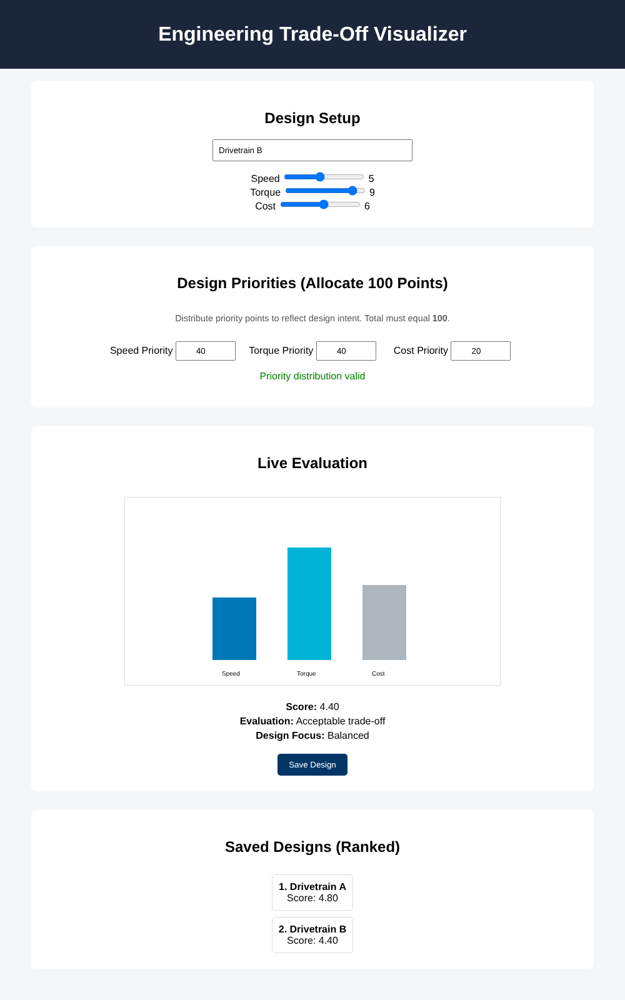

# Engineering Trade-Off Visualizer

A web version of my [trade-off simulator](https://github.com/tanaymishra1/engineering-tradeoff-simulator). Move the sliders for speed, torque and cost, split 100 points between them, and the score and chart update right away. Saved designs get ranked by score, and any design that fails the torque rule goes below every design that passes.

Try it: https://tanaymishra1.github.io/engineering-tradeoff-visualizer/



## Why I made it

The Python version makes you type everything in and only shows the result at the end. I wanted to see it change as I moved things around.

## Running it

Use the link above, or download the repo and open index.html in a browser. Nothing to install.

## How it works

It's plain HTML, CSS and JavaScript. Every slider and priority box has an input listener that recalculates the score and redraws the chart.

The scoring is the same as the Python version. Speed and torque get multiplied by their priority, cost gets multiplied by its priority and subtracted, and there's a one-point penalty if torque is under 5. That raw total becomes a score out of 100, where 0 is the worst design possible with your priorities and 100 is the best. Design focus uses the same rule as the Python version too, so both give the same results for the same inputs.

The chart shows how much speed, torque, cost and the penalty each add to or take away from the total. That way you can see why a design scored the way it did, not just the number.

The priorities can be decimals, like 33.4, 33.3 and 33.3. The total just has to be within 0.01 of 100. The chart also resizes to fit a phone screen.

Saved designs reset when you reload the page.

## Tests

The scoring math is in scoring.js, separate from the page code, so it can be tested without a browser. The tests use the same cases and numbers as the Python version's tests, so if the two ever stop matching, one of them fails.

```
node --test
```

GitHub runs them on every push.

## What I learned

This was my first time using DOM events, and my first time taking logic I wrote in Python and rebuilding it in JavaScript.

I also found out that 33.4 + 33.3 + 33.3 isn't exactly 100 in JavaScript. It comes out as 99.99999999999999, which is why the first version rejected it. Another one: slider values are text, so "10" > "9" is false until you turn them into numbers.

## To do

- Keep saved designs after a reload
- Compare two designs side by side
- Let users add their own criteria

MIT license.
